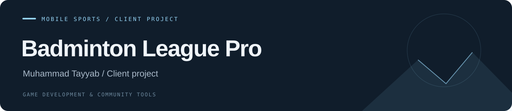

# Badminton League Pro

**Mobile Sports / Client Project · Client project**

A mobile badminton client project combining sports gameplay, optimized 3D assets and a clear game flow.

| Project | Details |
| --- | --- |
| Developer | Muhammad Tayyab |
| Progress | Client project |
| Tools / focus | Unity 6 · C# · Blender |
| Repository contents | Project documentation and repository configuration |

## Project focus

- Scoring, controls and shuttle physics.
- Blender assets optimized for mobile performance.
- UI elements and game flow.
- C# gameplay logic and animation integration in Unity 6.

## Repository status

This repository presents my development contributions. Client source files and game assets have not been uploaded.

## Media

See the [media guide](./media/README.md) for the project captures to add.

## Source project

The [source import guide](./docs/ADDING_SOURCE.md) describes the repository layout for adding the real Unity project.

---

[All projects](https://github.com/tabi-malikx) · [Project catalogue](https://github.com/tabi-malikx/tabi-malikx#selected-projects)
